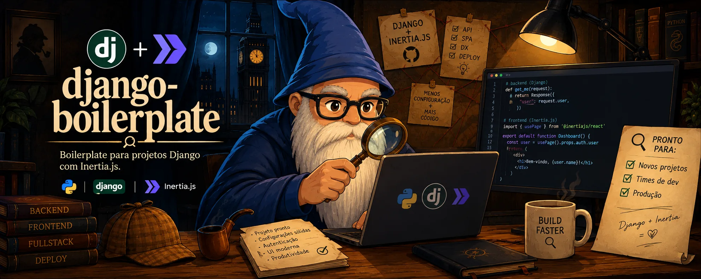

# Django Boilerplate

Este projeto de boilerplate em Django fornece uma estrutura básica para o desenvolvimento de aplicações web: backend Django com Celery e API REST, frontend React servido via Inertia.js e Vite, testes em três níveis e regras de arquitetura para desenvolvimento orientado a IA.

## Criando um novo projeto

Para usar este repositório como base de um projeto novo, rode uma vez no clone:

```bash
make init
```

O script pergunta o nome do projeto, o nome do pacote, a descrição, o autor, o banco de dados (nome, usuário e senha) e o prefixo dos containers Docker, e gera a `SECRET_KEY`. Depois atualiza `pyproject.toml`, `package.json`, `docker-compose.yml` e os arquivos de ambiente (`backend/config/settings/.env` e `.env/.env.local`). Esses arquivos de ambiente não vão para o git.

O script também oferece criar a `.venv` local. Ele procura um Python compatível com o `pyproject.toml` no `PATH`, no pyenv, no asdf e no uv. Se não encontrar, explica qual versão instalar e não altera nada.

Ao final, troca este README por um só com o nome do projeto (`# <Nome do projeto>`) e remove a si mesmo, o alvo `make init` e a capa do boilerplate (`.github/assets/`).

## Stack

**Backend**

- Python 3.13+ e Django 5.2
- PostgreSQL (SQLite quando `DATABASE_URL` não está definida)
- Celery + Redis, com `django-celery-beat`
- Django REST Framework, `drf-yasg` (Swagger) e `django-filter`
- `django-environ`, `django-storages` (S3) e `django-rosetta`
- `inertia-django` e `django-vite`
- Poetry para dependências

**Frontend**

- React 19 + TypeScript
- Inertia.js v3
- Vite 8
- Tailwind CSS v4 e shadcn/ui (estilo `base-nova`, ícones `lucide-react`)
- react-i18next
- Yarn 1 para dependências

**Qualidade**

- pytest + pytest-django (backend), Vitest + Testing Library + MSW (frontend) e Playwright (e2e)
- ruff para lint e formatação do Python

## Estrutura do projeto

```
.
├── .github/assets/          # Imagens do README
├── backend/                 # Projeto Django
│   ├── apps/                # Apps por domínio (account, core, upload)
│   │   └── <app>/
│   │       ├── CLAUDE.md    # Contexto e regras do app
│   │       └── tests/       # unit/ e integration/
│   ├── config/              # Settings (base, local, prod, test), urls, celery, wsgi/asgi
│   ├── conftest.py          # Fixtures e marcadores do pytest
│   └── manage.py
├── frontend/                # React + Inertia (alias @)
│   ├── main.tsx             # Entrada do Inertia
│   ├── app.css              # Tailwind + tema do shadcn
│   ├── components/ui/       # Componentes do shadcn/ui
│   ├── lib/                 # i18n, resolução de páginas, utils
│   ├── pages/               # Uma página por componente Inertia
│   ├── tests/               # Setup do Vitest, MSW, helpers e testes de integração
│   └── types/               # Tipos das props compartilhadas
├── e2e/                     # Testes end-to-end (Playwright)
├── compose/                 # Dockerfile e scripts dos containers
├── scripts/                 # init_project.py
├── CLAUDE.md                # Regras de arquitetura do projeto
├── docker-compose.yml
├── Makefile
├── package.json             # Dependências e scripts do frontend
├── playwright.config.ts
├── pyproject.toml           # Dependências Python, ruff e pytest
└── vite.config.ts           # Vite + Vitest
```

## Rodando com Docker

Pré-requisitos: Docker e Docker Compose.

```bash
make build env=local
make up env=local
```

Sobe o Django em <http://localhost:8000>, o Vite em <http://localhost:5173>, além de Postgres, Redis, worker e beat do Celery e o Flower em <http://localhost:5557>. As variáveis vêm de `.env/.env.local`.

```bash
make createsuperuser env=local   # cria um superusuário (admin em /staff/)
make down env=local
```

## Rodando sem Docker

Pré-requisitos: Python 3.13+, Poetry, Node 22.12+ e Yarn 1. O Django lê `backend/config/settings/.env`; sem `DATABASE_URL`, usa SQLite.

```bash
poetry install --with dev
yarn install
yarn dev                                   # servidor do Vite (assets com DEBUG=True)
poetry run python backend/manage.py migrate
poetry run python backend/manage.py runserver
```

Com `DEBUG=False`, o Django usa o build do Vite: rode `yarn build` antes.

O `manage.py` usa `config.settings.local` por padrão. Para outro módulo, use `--settings=config.settings.<módulo>` ou `export DJANGO_SETTINGS_MODULE=...`. O `.env` não escolhe o módulo de settings. Em produção, defina o `DJANGO_SETTINGS_MODULE` no ambiente do processo.

## Testes

Três níveis, separados por pasta, com um assert por teste. As regras estão na seção "Testes" do `CLAUDE.md`.

| Nível | Backend | Frontend |
|---|---|---|
| Unidade | `backend/apps/<app>/tests/unit/` | `frontend/**/*.test.ts(x)` |
| Integração | `backend/apps/<app>/tests/integration/` | `frontend/tests/integration/` |
| E2E | `e2e/*.spec.ts` (Playwright contra o Django real, com banco descartável) | |

```bash
make test-unit
make test-integration
make test-e2e          # na primeira vez: yarn playwright install chromium
make test              # os três
```

## Lint e formatação

```bash
make lint      # verifica (ruff check + ruff format --check)
make format    # corrige e formata
yarn typecheck # TypeScript
```

## Desenvolvimento com IA

O `CLAUDE.md` da raiz guarda as regras de arquitetura (camadas, exceções, i18n, API, frontend, testes) e cada app tem o seu `CLAUDE.md` com o contexto do domínio. Agentes de IA, como o Claude Code, leem esses arquivos automaticamente. Mantenha-os atualizados junto com o código. Skills de agentes ficam em `.agents/skills/` (`skills-lock.json`).

## Bucket Access Policy

```json
{
    "Version": "2012-10-17",
    "Statement": [
        {
            "Sid": "PrivateAccessForMedia",
            "Effect": "Allow",
            "Action": [
                "s3:DeleteObject",
                "s3:GetObject",
                "s3:ListBucket",
                "s3:PutObject"
            ],
            "Resource": [
                "arn:aws:s3:::<bucket_name>",
                "arn:aws:s3:::<bucket_name>/media/*"
            ]
        },
        {
            "Sid": "PrivateAccessForStatic",
            "Effect": "Allow",
            "Action": [
                "s3:GetObject",
                "s3:PutObject"
            ],
            "Resource": [
                "arn:aws:s3:::<bucket_name>/static/*"
            ]
        }
    ]
}
```

## Licença
Este projeto está licenciado sob a licença MIT. Veja o arquivo [LICENSE](LICENSE) para mais detalhes.
